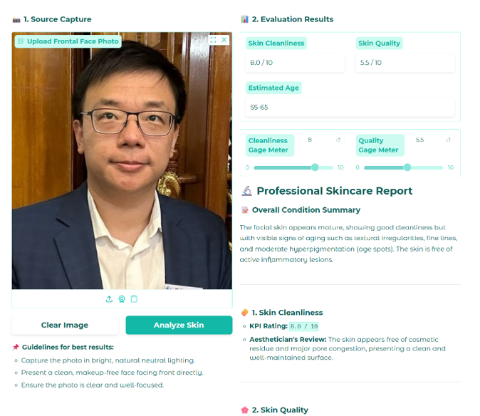

# 需求

Write a single Python script using Gradio or Flask to create a simple web UI that runs in a local browser for quality checking skin.

API key: 13406d59-bab5-4d4e-9e9b-bc6b126f73b9

API_URL =
"https://genai.hkbu.edu.hk/api/v0/rest/deployments/gemini-2.5-pro/chat/completions?api-version=v1"

Requirements:
	UI: A simple interface with an imagev_1 v_1 upload button and a submit button.
	LLM Integration: Us the LLM API key and URL provided
	Output: Display the LLM's response on the UI, which must include:
	Skin Cleanliness KPI (e.g., score out of 10)
	Skin Quality KPI (e.g., score out of 10)
	A brief description of the face image skin condition
	Estimated age
Single File: Keep all backend, API call, and UI code in one single .py file. Do not use Streamlit.

This is the exapmle photo:

I want to add some new function:

1. The Login page (user can input their user name and password there, and also set up a demo account(password also "demo") for demonstration)
2. Add the Tabs of History, the main page named "Home". This need to show the line chart with skin cleanliness and skin Quality in different time(the each time user upload their photo, in demo I will give you some photos to show the chart template). The chart in the left side, and user can click the point in the chart,after clicking, the right side can show the corresponding uploaded photo at that time and the skincare tips( it is a little different as the main page, add a new nevigation link for "What skin treatment program can improve..."
3. The tab of Recomment need to related to the skin condition(the specific time is user chooses). base on their skin condition to recommend **Medical beauty projects to them, and list prices and effects, and reservation(these are located in left side and in Independent Scrolling / Local Scrolling, you need to list specific project in their own text box to Distinguish it from other projects)** . To show the effect, we can set the predict line chart at the right side. And after users click reservation, you need to have a reservation form under the chart at the right side. Users can select daytime ,specific time and pay there.

you can do this first and I will add another function after it is completed.

If you have read this document, please add "~" at the end of each chat